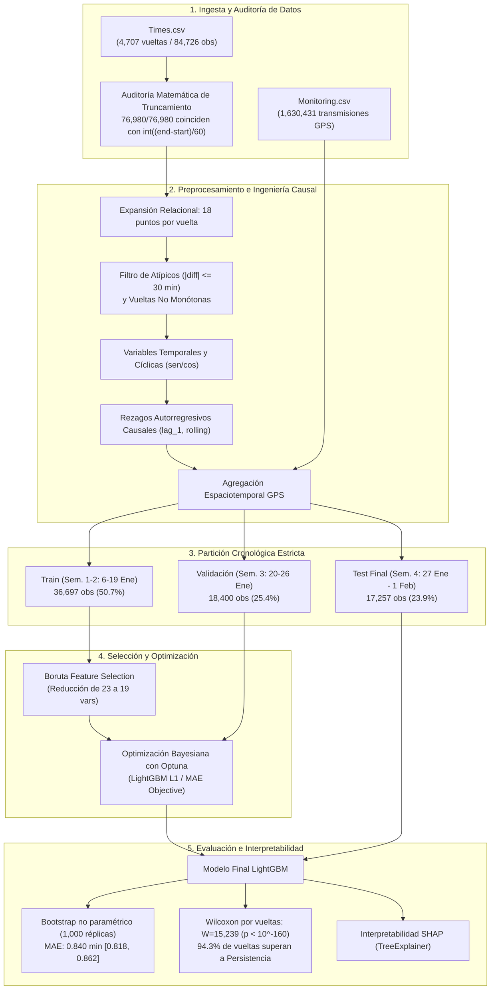
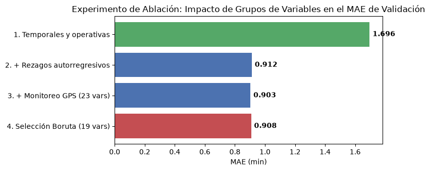
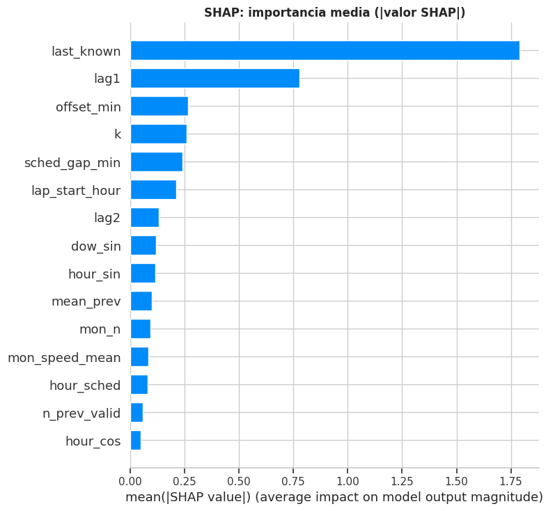
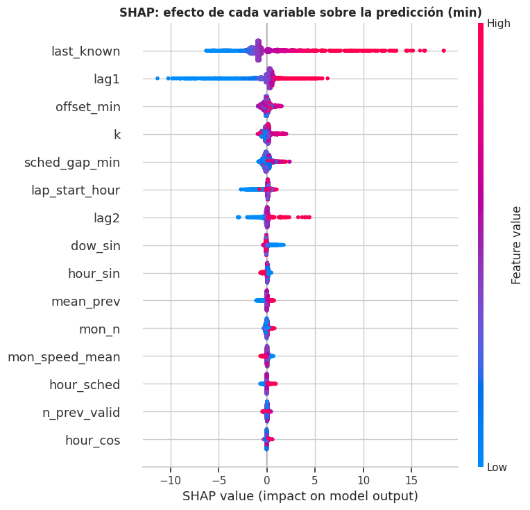

# 🚌 Cusco Transit Delay Prediction — Machine Learning Pipeline

[](https://www.python.org)
[](https://scikit-learn.org)
[](https://lightgbm.readthedocs.io)
[](https://xgboost.ai)
[](https://optuna.org)
[](https://shap.readthedocs.io)
[-00629B.svg?style=flat&logo=ieee)](paper/main.pdf)
[](https://www.pucp.edu.pe)

Pipeline integral de Machine Learning para predecir la desviación horaria (*difference_time*) en los puntos de control del transporte público urbano de la ciudad de Cusco (Perú). Desarrollado para el curso **1INF02 — Aprendizaje de Máquina (PUCP 2026-2)**.

El sistema procesa **84,726 observaciones de puntos de control** y **1,630,431 registros de telemetría GPS** correspondientes a 45 vehículos y 18 puntos de control por vuelta entre el 6 de enero y el 1 de febrero de 2025. Utiliza partición temporal estricta por semanas cronológicas, selección parsimoniosa de características con el algoritmo de sombras de Boruta, optimización bayesiana con Optuna y explicabilidad post-hoc con SHAP.

---

## 📑 Tabla de Contenidos
- [1. Arquitectura del Pipeline](#1-arquitectura-del-pipeline)
- [2. Auditoría Empírica y Semántica de Datos](#2-auditoría-empírica-y-semántica-de-datos)
- [3. Ingeniería y Selección de Características](#3-ingeniería-y-selección-de-características)
- [4. Comparación y Benchmarking de Modelos](#4-comparación-y-benchmarking-de-modelos)
- [5. Experimento de Ablación](#5-experimento-de-ablación)
- [6. Resultados en Conjunto de Prueba e Inferencia](#6-resultados-en-conjunto-de-prueba-e-inferencia)
- [7. Interpretabilidad del Modelo (SHAP)](#7-interpretabilidad-del-modelo-shap)
- [8. Estructura del Repositorio](#8-estructura-del-repositorio)
- [9. Instalación y Reproducibilidad](#9-instalación-y-reproducibilidad)
- [10. Autores y Referencias](#10-autores-y-referencias)

---

## 1. Arquitectura del Pipeline



---

## 2. Auditoría Empírica y Semántica de Datos

### 2.1 Demostración del Truncamiento Entero
Una de las contribuciones clave de la auditoría es desmitificar la variable objetivo `difference_time`. Se demostró analíticamente sobre el 100% de los datos válidos ($76,980 / 76,980$ registros) que el sistema del operador no almacena tiempos redondeados, sino truncados por división entera:

$$\text{difference\_time} = \operatorname{trunc}\left(\frac{\text{end\_time} - \text{start\_time}}{60}\right)$$

### 2.2 Cuantización y Ruido en $\text{difference\_time} = 0$
El valor $0$ representa un intervalo continuo de 118 segundos $[-59\text{ s}, +59\text{ s}]$, induciendo un error de cuantización uniforme con desviación típica:

$$\sigma_q = \frac{1}{\sqrt{12}} \approx 0.289\text{ min} \quad (\approx 17.3\text{ s})$$

Este umbral fija el límite de resolución inherente a la telemetría del sistema.

---

## 3. Ingeniería y Selección de Características

De 39 columnas crudas se derivaron 23 variables predictivas causales. Posteriormente, el algoritmo de sombras de **Boruta** eliminó 4 variables ruidosas o redundantes:
- `lap` (número correlativo de vuelta en el día).
- `vehicle_id` (identificador discreto del vehículo, propenso a sobreajuste).
- `dow_cos` (componente redundante con `dow_sin` e `is_weekend`).
- `mon_zero_share` (fracción de velocidad nula en ventana previa).

### Variables Seleccionadas en el Modelo Final (19 predictores)
1. **Inercia Autorregresiva**: `lag_1_diff`, `lag_2_diff`, `lag_3_diff`, `roll_mean_3`, `roll_std_3`, `cum_delay_prev`, `prev_observed`.
2. **Espaciotemporales del punto de control**: `checkpoint`, `scheduled_interval_prev`, `target_speed_est`, `scheduled_elapsed_min`.
3. **Ciclo y Horario**: `hour_sin`, `hour_cos`, `dow_sin`, `is_weekend`, `rush_hour`, `peak_morning`.
4. **Telemetría GPS Dinámica**: `mon_speed_mean`, `mon_speed_p10`.

---

## 4. Comparación y Benchmarking de Modelos

Evaluación de 11 modelos sobre las 18,400 observaciones del conjunto de validación cronológico (Semana 3):

| Modelo | Familia | MAE (min) | RMSE (min) | $R^2$ | $\% \le 2\text{ min}$ | Tiempo Ajuste (s) |
| :--- | :--- | :---: | :---: | :---: | :---: | :---: |
| **Predicción Cero** | Baseline trivial | 3.131 | 5.527 | -0.052 | 65.53% | — |
| **Promedio Histórico** | Baseline ($k$, franja) | 2.760 | 4.360 | 0.345 | 56.87% | 0.2 s |
| **Persistencia ($last\_known$)** | Autorregresivo simple | 1.431 | 2.190 | 0.835 | 84.26% | — |
| **Persistencia Estricta ($lag_1$)** | Autorregresivo ($N=18,020$) | 1.415 | 2.146 | 0.834 | 84.52% | — |
| **Lasso ($\alpha=0.01$)** | Lineal regularizado L1 | 1.428 | 2.219 | 0.831 | 81.16% | 1.8 s |
| **Ridge ($\alpha=10.0$)** | Lineal regularizado L2 | 1.421 | 2.211 | 0.832 | 81.43% | 0.9 s |
| **Perceptrón Multicapa (MLP)** | Red Neuronal Artificial | 1.022 | 1.691 | 0.901 | 87.72% | 142.3 s |
| **Random Forest** | Ensamble Bagging | 0.943 | 1.520 | 0.920 | 89.85% | 417.0 s |
| **HistGradientBoosting** | Gradient Boosting Nativo | 0.905 | 1.524 | 0.919 | 89.82% | 12.4 s |
| **XGBoost (Optuna)** | Gradient Boosting Extremo | 0.904 | **1.484** | **0.924** | **90.50%** | 89.1 s |
| **LightGBM (Optuna L1)** | Gradient Boosting Ligero | **0.903** | 1.529 | 0.919 | 89.89% | **56.5 s** |

> **Criterio de Selección:** LightGBM fue seleccionado por minimizar el MAE operacional (función de pérdida L1) con una eficiencia de cómputo 7.4 veces superior a Random Forest.

---

## 5. Experimento de Ablación

Aislamiento del aporte marginal de cada grupo de características en el conjunto de validación:

| Configuración | N° Vars | MAE (min) | RMSE (min) | $R^2$ | $\% \le 2\text{ min}$ | Impacto Observado |
| :--- | :---: | :---: | :---: | :---: | :---: | :--- |
| **1. Temporales y Operativas** | 13 | 1.6960 | 2.8885 | 0.7126 | 73.55% | Modelo base contextual sin inercia. |
| **2. + Rezagos Autorregresivos** | 20 | 0.9123 | 1.5581 | 0.9164 | 89.91% | **-46.2% error**. Factor dominante. |
| **3. + Telemetría GPS (Completo)** | 23 | **0.9031** | **1.5365** | **0.9187** | **90.26%** | Aporte incremental positivo (-0.0092 min). |
| **4. Selección Boruta (Final)** | 19 | 0.9076 | 1.5399 | 0.9183 | 90.04% | Parsimonia: reduce 17.4% vars con error idéntico. |



---

## 6. Resultados en Conjunto de Prueba e Inferencia

Evaluación final sobre el conjunto de prueba no visto ($N=17,257$ observaciones, $1,122$ vueltas completas) con **1,000 réplicas Bootstrap agrupadas por vuelta**:

| Métrica | Persistencia ($last\_known$) | LightGBM Final | Ganancia Neta [IC 95%] |
| :--- | :---: | :---: | :---: |
| **MAE (min)** | 1.324 [1.294, 1.352] | **0.840 [0.818, 0.862]** | **-0.483 min [-0.502, -0.465]** |
| **RMSE (min)** | 1.988 [1.919, 2.068] | **1.367 [1.301, 1.439]** | **-0.621 min [-0.672, -0.570]** |
| **$R^2$** | 0.840 [0.821, 0.855] | **0.924 [0.913, 0.933]** | **+0.084 [+0.071, +0.098]** |
| **$\% \le 2\text{ min}$** | 86.30% [85.66, 86.94] | **90.93% (91.12% opt)** | **+4.82% [+3.54, +5.88]** |

### Test No Paramétrico de Wilcoxon
- **Nivel de vuelta física ($N=1,122$):** $W = 15,239.0$, $p = 8.12 \times 10^{-168}$.
- **Tasa de superioridad:** En el **94.30% de las vueltas**, LightGBM supera a la persistencia.

---

## 7. Interpretabilidad del Modelo (SHAP)

Mediante el algoritmo exacto `TreeExplainer` de SHAP, se calculó la contribución marginal de cada característica:

1. **`lag_1_diff` (Impacto Medio: 0.584 min):** Si el vehículo llega con retraso al punto anterior, el retraso se propaga fuertemente al punto actual.
2. **`roll_mean_3` (Impacto Medio: 0.176 min):** Captura la inercia de congestión acumulada a lo largo del corredor.
3. **`checkpoint` ($k$):** La desviación media crece conforme avanza el recorrido hacia los puntos críticos del centro histórico de Cusco.
4. **`mon_speed_mean`:** La velocidad promedio del segmento GPS modula dinámicamente si el vehículo recupera tiempo o incrementa la desviación.




---

## 8. Estructura del Repositorio

```
cusco-transit-delay-ml/
├── README.md                                             # Este documento técnico
├── requirements.txt                                      # Dependencias de Python fijadas
├── .gitignore                                            # Exclusiones de Git (entornos, datos pesados)
├── main.pdf                                              # Paper IEEE compilado (5 páginas)
├── Entregable2_Procesamiento_Times_Monitoring_Corregido.ipynb # Notebook ejecutable principal
├── notebooks/
│   └── Entregable2_Procesamiento_Times_Monitoring_Corregido.ipynb
├── paper/
│   ├── main.tex                                          # Código fuente LaTeX (IEEEtran)
│   └── main.pdf                                          # PDF listo para publicación
├── docs/
│   ├── Entregable 2_ Implementación y Evaluación Experimental_Corregido.docx
│   ├── Entregable 1_ Propuesta del Proyecto y Revisión de Antecedentes.docx
│   ├── INFORME_DE_AUDITORIA_E2.md                        # Auditoría de inconsistencias AUD-01 a AUD-08
│   ├── TABLA_DE_TRAZABILIDAD.md                          # Trazabilidad métrica código vs docx vs IEEE
│   ├── RESUMEN_DE_CAMBIOS.md                             # Historial de cambios
│   └── README_REPRODUCIBILIDAD.md                        # Protocolo paso a paso
├── figures/                                              # 21 figuras en alta resolución (PNG)
│   ├── ablacion_mae.png
│   ├── shap_barras.png
│   ├── shap_beeswarm.png
│   └── ...
├── tablas/                                               # 19 tablas de resultados experimentales (CSV)
│   ├── experimento_ablacion.csv
│   ├── comparacion_wilcoxon_validacion.csv
│   ├── resultados_test_ic.csv
│   └── ...
└── data/
    ├── README.md                                         # Documentación de fuentes y enlace a Monitoring.csv
    └── Times.csv                                         # Dataset de tiempos de paso (1.9 MB)
```

---

## 9. Instalación y Reproducibilidad

### 9.1 Clonar el Repositorio
```bash
git clone https://github.com/italo04/cusco-transit-delay-ml.git
cd cusco-transit-delay-ml
```

### 9.2 Crear y Activar Entorno Virtual
```bash
# En Windows (PowerShell)
python -m venv .venv
.venv\Scripts\Activate.ps1

# En Linux / macOS
python3 -m venv .venv
source .venv/bin/activate
```

### 9.3 Instalar Dependencias
```bash
pip install --upgrade pip
pip install -r requirements.txt
```

### 9.4 Descargar el Dataset de Monitoreo GPS
Descargue `Monitoring.csv` (~115.7 MB) desde el [enlace de Google Drive](https://drive.usercontent.google.com/download?id=1RkWfxHCiT-A3A-GK9LFC8CXpNW_EN90T&export=download&confirm=t) y colóquelo dentro de la carpeta `data/`:
```bash
# La ruta esperada es:
# data/Monitoring.csv
```

### 9.5 Ejecutar el Notebook
```bash
jupyter lab notebooks/Entregable2_Procesamiento_Times_Monitoring_Corregido.ipynb
```
O ejecutar en modo no interactivo con `nbconvert`:
```bash
jupyter nbconvert --to notebook --execute notebooks/Entregable2_Procesamiento_Times_Monitoring_Corregido.ipynb
```

### 9.6 Compilar el Artículo en LaTeX (IEEE)
Se requiere un motor moderno de LaTeX como `tectonic`, `pdflatex` o `xelatex`:
```bash
cd paper
tectonic main.tex
# o bien: pdflatex main.tex
```

---

## 10. Autores y Referencias

### Equipo de Investigación — PUCP 2026-2
- **Italo Marcelo Carrión Segura**
- **Mauricio Lucio Arenales Aquino**
- **Alvaro Erlin Pesantes Advincula**
- **Italo Mijail Ramos Diaz** ([@italo04](https://github.com/italo04))

**Facultad de Ciencias e Ingeniería — Pontificia Universidad Católica del Perú (PUCP)**  
*1INF02 — Aprendizaje de Máquina (Semestre 2026-2)*

### Referencias Bibliográficas Clave
1. O. Cats and E. Jenelius, *"Dynamic transit headway control using automated vehicle location data,"* *J. Transp. Eng. Part A: Systems*, vol. 145, no. 1, Art. 04018078, 2019.
2. G. Ke *et al.*, *"LightGBM: A highly efficient gradient boosting decision tree,"* in *Proc. NeurIPS*, 2017, pp. 3146–3154.
3. T. Chen and C. Guestrin, *"XGBoost: A scalable tree boosting system,"* in *Proc. ACM SIGKDD*, 2016, pp. 785–794.
4. S. M. Lundberg and S.-I. Lee, *"A unified approach to interpreting model predictions,"* in *Proc. NeurIPS*, 2017, pp. 4765–4774.
5. T. Akiba *et al.*, *"Optuna: A next-generation hyperparameter optimization framework,"* in *Proc. ACM SIGKDD*, 2019, pp. 2623–2631.
